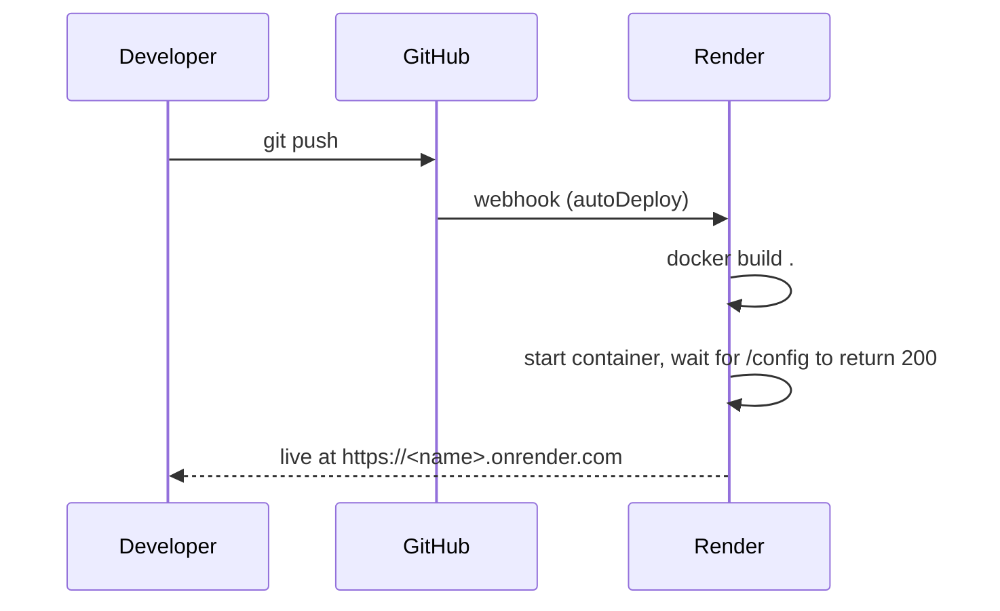

# 7 · Deployment

This is the **free-tier edition** of LUXE. It runs as a single container on
**Render** (free web service), built and deployed automatically from GitHub on
every push. Everything else — MongoDB Atlas (M0), Groq, Logfire — is on its
free tier too, so a demo costs **$0**.

For the step‑by‑step setup, see [`commands.md`](../commands.md) in the repo
root. This page explains *what* is used and *why*.

## Services used

| Service | What it does here | Cost |
|---------|-------------------|------|
| **Render Web Service** (Docker runtime, free plan) | Builds the `Dockerfile` and runs the container. Gets a public HTTPS URL (`https://<name>.onrender.com`). Redeploys automatically on every push to the linked branch. Replaces Cloud Build + Artifact Registry + Cloud Run. | $0 |
| **Render Environment Variables** | Hold `MONGO_URI`, `GOOGLE_CLIENT_ID`, `GROQ_API_KEY`, `LOGFIRE_TOKEN`. Replaces Secret Manager. Values live in the Render dashboard, never in the repo. | $0 |
| **MongoDB Atlas (M0)** | The database. Free 512 MB cluster. | $0 |
| **Groq** | Every language‑model call. Free tier with rate limits. | $0 |
| **Pydantic Logfire** | Tracing. Free tier. Optional. | $0 |
| **Google Cloud Console (OAuth client only)** | Hosts the "Sign in with Google" client ID. No billing, no compute. | $0 |

**Blueprint:** [`render.yaml`](../render.yaml) at the repo root describes the
service, so it can be created in one step (**New → Blueprint**) instead of by
hand.

**Region:** Render has no Mumbai region. `render.yaml` uses **Singapore**, the
closest. For the lowest database latency, create the Atlas cluster in
`ap-southeast-1` (Singapore) too.

**Portkey is optional and not wired into the deploy.** The app runs fine without
it (a no-op fallback to calling Groq directly, see
`backend/utils/llm_gateway.py`). Add `PORTKEY_API_KEY` and
`PORTKEY_GROQ_PROVIDER` as environment variables to turn it on.

**Logfire needs a real token to actually send anything.** With a blank
`LOGFIRE_TOKEN`, `send_to_logfire='if-token-present'` makes every trace a
silent no‑op — the app still works.

## The container image

One image, built from the repo-root `Dockerfile`, running the **monolith**
(`main.py` — the storefront, every API endpoint, and the AI chat pipeline, all
in one process). The container listens on the port Render provides in `$PORT`
(falls back to 8000 locally).

## The pipeline



If the health check (`/config`) fails, Render keeps the previous version
running, so a bad deploy doesn't take the site down.

## Environment variables

Set in the Render dashboard (**Environment** tab), not in the repo:

| Variable | Purpose |
|----------|---------|
| `MONGO_URI` | database connection (required) |
| `GROQ_API_KEY` | the shopping agent's and guardrails' language-model calls (required for chat) |
| `GOOGLE_CLIENT_ID` | Google Sign‑In (optional) |
| `LOGFIRE_TOKEN` | tracing + online eval scores (optional) |
| `ONLINE_EVALS_ENABLED` | `false` by default; keep off to avoid extra LLM calls |

To change a value (e.g. after rotating the DB password): edit it in the
**Environment** tab and save — Render redeploys automatically.

## Free-tier behaviour to know about

| Behaviour | Effect | Mitigation |
|-----------|--------|------------|
| **Sleeps after ~15 min idle** | The first request after a pause takes roughly 30–60 s while the container wakes. | Open the site a minute before a demo, or ping it every ~10 min with a free monitor such as UptimeRobot. |
| **512 MB RAM** (vs 1 Gi on Cloud Run) | Fine for normal use; heavy bulk imports could run out. | Keep bulk uploads small, or upgrade to the Starter plan (~$7/mo, always on). |
| **~750 free instance hours / month** | Enough for one always-available service. | — |
| **Changing outbound IPs** | Atlas can't be IP-allowlisted to the service. | Allow `0.0.0.0/0` in Atlas **Network Access** and keep a strong DB password. Acceptable for a demo only. |
| **Groq free-tier rate limits** | Chat can be throttled under load. | Run through the chat flow before a live demo. |
| **512 MB Atlas M0** | Product images are stored as base64 in MongoDB, so many uploads fill it. | Use the bundled `demo_data`, keep image counts small. |

## Running it yourself without Render

```bash
python main.py   # one process, everything on http://localhost:8000
```

Reads configuration from a `.env` file (copy `.env.example`).
